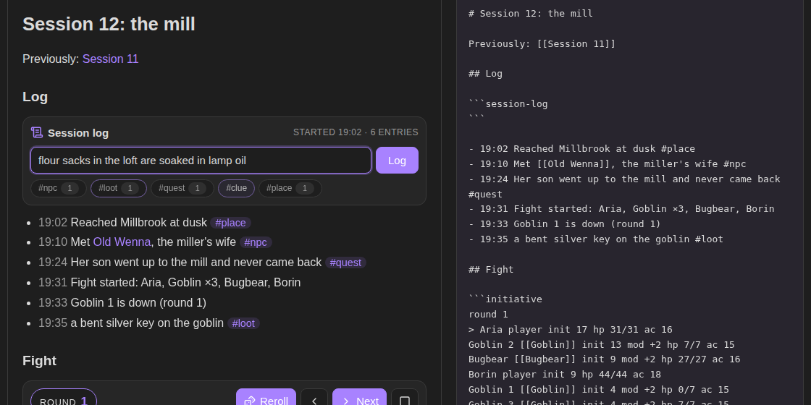

# Session Log

A quick log for tabletop sessions in Obsidian. Type what just happened and it lands in your session note with the time, tags and links, so the recap is written by the end of the night.



**Try it in your browser** before installing: https://bulkhead.bananafest-destiny.com/press/session-log/ runs the real plugin code over a sample session note, together with Quick Initiative.

## Start a log

Put a `session-log` block in your session note:

````
## Log

```session-log
```
````

In reading view (or live preview) the block becomes a box. Type a line and press Enter:

```
- 19:10 Met [[Old Wenna]], the miller's wife #npc
```

Each entry goes at the end of the list under the block. It is an ordinary Markdown list, so `[[links]]` show up as backlinks on the linked note and `#tags` show up in tag search. Click a quick tag under the box to add it to the next entry; the number on each tag counts this session's entries with it.

## Commands

| Command | What it does |
| --- | --- |
| Add log entry | opens the same box from anywhere. Give it a hotkey and you can log without leaving the map or the statblock you are reading |
| New session note | makes `Session 13` in your session folder, with today's date, a link to `Session 12`, and a log ready to go |
| Insert log block | puts a `session-log` block at the cursor |

**Add log entry** writes to the open note if it has a log, otherwise to the last log you used.

## Fights

With [Quick Initiative](https://github.com/walkertbrown/quick-initiative) installed, fights log themselves:

```
- 20:14 Fight started: Aria, Borin, Goblin ×3, Bugbear
- 20:19 Goblin 1 is down (round 2)
- 20:31 Fight over after 4 rounds. Down: Goblin ×3
```

A fight in the session note goes into its log. A fight in another note (a dungeon room, say) goes into the last log you used. Turn this off in settings.

## Settings

- **Quick tags**: the tags under the box, separated by commas. Default `npc, loot, quest, clue, place`.
- **Add the time** and **24-hour clock**: `20:14`, `8:14pm`, or no time at all.
- **Log fights**: on by default.
- **Session folder**: where **New session note** puts notes. Default `Sessions`.

## Privacy

Session Log does not use the network, has no accounts, collects nothing and sends nothing. It only adds lines under the `session-log` block, and makes notes when you run **New session note**.

## Install

From Obsidian: Settings → Community plugins → Browse → search "Session Log".

By hand: copy `main.js`, `manifest.json` and `styles.css` from the latest release into `<your vault>/.obsidian/plugins/session-log/`, then enable it under Community plugins.

## Also from this maker

- [Quick Initiative](https://github.com/walkertbrown/quick-initiative): an initiative tracker that keeps the fight as plain text in your note and reads Fantasy Statblocks creature notes.
- [Dice Tray](https://github.com/walkertbrown/dice-tray): rolls dice, random tables and note sections inline, and reads Dice Roller's `dice:` syntax.
- [Encounter Builder](https://github.com/walkertbrown/encounter-builder): plan fights against the 5E XP budget, then start them in Quick Initiative.

## Source

https://github.com/walkertbrown/session-log

## Build

```
npm install
npm test
npm run build
```

MIT licensed.
